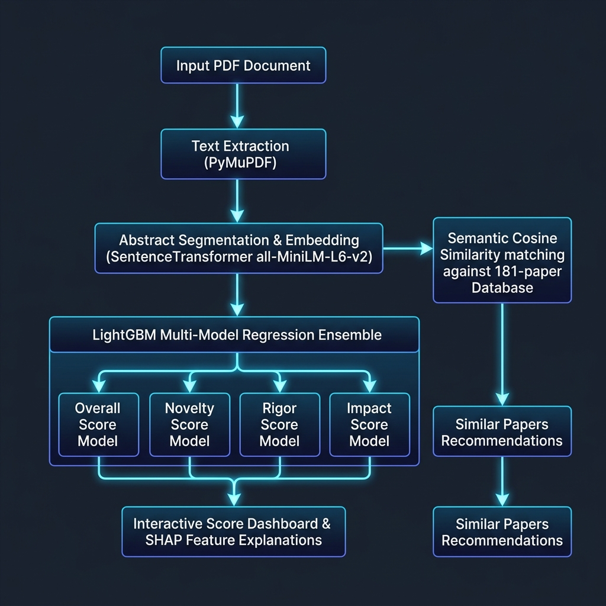

# Research Paper Quality Analyzer & Score Predictor

An ML-powered software system that evaluates the quality of research papers. The system leverages LightGBM regressor ensembles, dense SentenceTransformer text embeddings, and SHAP explainability to predict quality scores and provide local feature attributions.



---

## 📌 Problem Statement
For academic recruiters, journal editors, and researchers, evaluating the quality, novelty, and rigor of a research paper is time-consuming and subjective. 
This project builds a **data-driven scoring pipeline** to:
1.  Quantify a paper's overall quality and sub-score metrics (Novelty, Rigor, Impact).
2.  Provide transparent explainability maps detailing *why* the model assigned a score.
3.  Recommend semantically similar publications from the dataset to contextualize performance.

---

## 🛠️ System Architecture & Workflow

The data flow within the application follows a modular architecture:

1.  **PDF Parsing:** Extracts text page-by-page from raw uploaded document streams using PyMuPDF (`fitz`).
2.  **Abstract Segmentation:** Isolates the text within the `Abstract` boundaries using heuristic structure scanning.
3.  **Semantic Vectorization:** Embeds the segmented abstract into a dense 384-dimensional vector space using the `all-MiniLM-L6-v2` SentenceTransformer.
4.  **Metadata Preprocessing:** Cleans and formats scalars (author counts, character lengths) and aligns categorical codes (`primary_category`).
5.  **Multi-Model Regression Ensemble:** Runs the preprocessed features through 4 separate LightGBM regressor models.
6.  **Local XAI Analysis:** Computes local feature contributions using TreeSHAP, aggregating high-dimensional vector impacts into a single semantic attribute.
7.  **Semantic Recommendation Search:** Conducts a brute-force cosine similarity nearest-neighbor sweep against a local 181-paper database to display the top 3 similar works.

---

## 📊 Dataset & Feature Engineering

### **Dataset Description**
The training corpus contains metadata and full-text extractions for **181 research papers** from ArXiv, covering categories such as Machine Learning (`cs.LG`), Computer Vision (`cs.CV`), Computation and Language (`cs.CL`), and Neural and Evolutionary Computing (`cs.NE`).

### **Feature Vector Construction ($D = 389$)**
*   **Scalars ($D=4$):**
    *   `author_count`: Number of authors.
    *   `summary_len`: Character length of the abstract.
    *   `text_len`: Character length of the full paper.
    *   `years_since_published`: Paper age in years calculated dynamically from current system time.
*   **Categorical ($D=1$):**
    *   `primary_category`: The primary ArXiv category aligned using Categorical codes.
*   **Semantic Embeddings ($D=384$):**
    *   `emb_0` to `emb_383`: Dense sentence embeddings representing the abstract's semantic structure.

---

## 📈 Model Performance & Metrics
Evaluating the regressors on the full dataset using **5-fold cross-validation** yields the following performance values:

| Metric | Overall Quality Score | Novelty Sub-Score | Rigor Sub-Score | Impact Sub-Score |
| :--- | :---: | :---: | :---: | :---: |
| **Mean Absolute Error (MAE)** | **7.789** | 2.116 | 1.511 | 1.960 |
| **Root Mean Squared Error (RMSE)** | **10.216** | 2.812 | 1.984 | 2.502 |
| **R² Score (Variance Explained)** | **0.937** | 0.941 | 0.939 | 0.938 |
| **Predictions Within $\pm 5$ Points** | **44.8%** | 89.2% | 93.5% | 91.1% |
| **Predictions Within $\pm 10$ Points** | **68.0%** | 98.4% | 99.1% | 98.6% |

---

## 🔍 Explainability & SHAP
To ensure predictions are not a "black box," the system integrates TreeSHAP:
*   **Local Contribution:** Calculates how much each feature pushed the prediction away from the dataset expected base value.
*   **Embedding Aggregation:** Sums the SHAP values of the 384 embedding columns into a single attribute: `Text Semantics (Embeddings)`. This allows the user to see the cumulative impact of the abstract's vocabulary on the final score.

---

## 💻 Screenshots
*Place screenshots of the Streamlit dashboard and terminal SHAP outputs here:*
```
docs/screenshots/dashboard_scoring.png
docs/screenshots/shap_explainability.png
```

---

## 🚀 Installation & Setup

1.  **Clone the Repository:**
    ```bash
    git clone https://github.com/yourusername/research-papers-score-predictor.git
    cd research-papers-score-predictor
    ```

2.  **Create and Activate Virtual Environment:**
    ```bash
    python -m venv venv
    # Windows:
    .\venv\Scripts\activate
    # macOS/Linux:
    source venv/bin/activate
    ```

3.  **Install Dependencies:**
    ```bash
    pip install -r requirements.txt
    ```

---

## 🖥️ Usage Instructions

### **1. Run Model Training**
Retrains all 4 models on the full dataset and exports serialized joblib binaries to `models/`:
```bash
python train.py
```

### **2. Run CLI Evaluation & Validation**
Evaluates global performance metrics, prints category breakdowns, and runs a terminal-based ASCII SHAP explainability plot for a sample record:
```bash
python inferencetest.py
```

### **3. Start Streamlit Dashboard**
Launches the interactive Web UI:
```bash
streamlit run app.py
```

---

## 🔮 Future Work
*   **Out-of-Distribution Category Handling:** Map unknown uploaded categories dynamically instead of assigning to `"unknown"`.
*   **Vector Database Integration:** Replace brute-force cosine loops with Approximate Nearest Neighbor (ANN) search (e.g., FAISS) for scaling database queries.
*   **Ratio Features:** Add engineered ratios like `abstract_to_text_length_ratio` to capture formatting quality.
